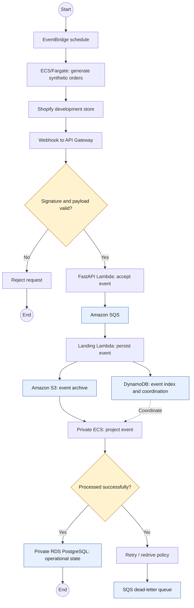
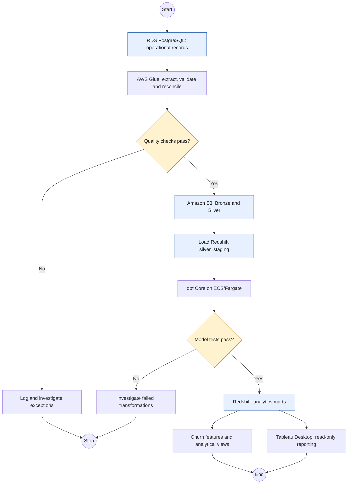

# Real-Time E-commerce Analytics

AWS-based Shopify order ingestion, operational processing, dimensional analytics, and customer-retention modeling. Shopify transactions in this demonstration are **synthetic**; historical Online Retail II data and generated events have distinct provenance.

## System activity diagrams

The diagrams below separate **operational event processing** from **warehouse transformation**. Solid arrows represent the primary processing path; decision nodes show validation and retry handling.

### 1. Shopify event processing



### 2. Operational data to analytics



- **Ingestion and operations:** Shopify event generation, webhook validation, durable event storage, queue-based processing, and private PostgreSQL operational state.
- **Analytics:** Glue extraction and validation, Redshift staging, dbt dimensions/facts and churn-feature marts with data-quality tests.
- **Reporting:** Tableau connects to Redshift analytics schemas through controlled read-only access.
- **Infrastructure:** Terraform and CloudFormation manage AWS resources in `eu-central-1`. Deployment uses private application and isolated database networking where required.


The churn model and transactions are a demonstration, **not** a production decision system or real-customer revenue pipeline.

## Repository guide

| Location | Purpose |
| --- | --- |
| `src/ecommerce/`, `apps/` | Domain, application, interfaces, and AWS workloads |
| `scripts/`, `scripts/aws/`, `scripts/glue/` | Ingestion, deployment and orchestration |
| `infrastructure/terraform/` | Core AWS infrastructure as code |
| `infrastructure/cloudformation/` | Separately managed infrastructure stacks |
| `analytics/dbt/`, `analytics/redshift/`, `scripts/redshift/` | Warehouse transformations, SQL and access controls |
| `tests/` | Unit, integration and infrastructure checks |

## Local development

```powershell
python -m pip install -e ".[dev,historical,aws]"
ruff check src apps tests
python -m pytest -q tests/unit
```

Read [Terraform safeguards](infrastructure/terraform/README.md) before changing AWS resources. Historical ingestion entrypoints are documented in [scripts/README.md](scripts/README.md).
