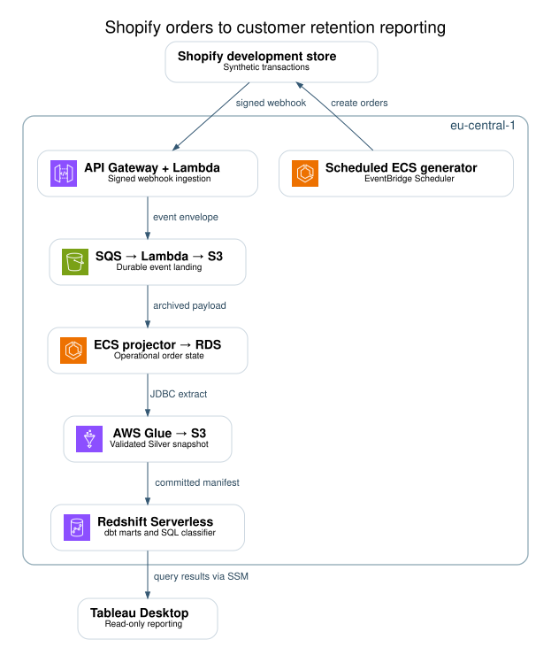

# Real-Time E-commerce Analytics on AWS

**An event-driven data engineering project that turns Shopify transactions into reliable sales reporting and customer-retention insights.**

A sales event is only useful for analytics when it is **captured, processed once, reconciled, and reflected in the reporting tables**. This project builds that path end to end: simulated Shopify orders enter through secure webhooks, are processed into PostgreSQL, and then flow through AWS Glue, Amazon Redshift Serverless, and dbt into Tableau-ready data models.

The platform is designed around an important constraint: **the private application database and outbound networking do not need to run continuously.** Incoming events can be accepted while RDS is stopped; scheduled processing and reconciliation carry them through to analytics later.

## At a glance

| Question | Answer |
| --- | --- |
| **What is this?** | A portfolio-scale, AWS-hosted e-commerce data platform covering event ingestion, transactional processing, analytics engineering, and churn modeling. |
| **Why build it?** | To demonstrate how unreliable or out-of-order event delivery becomes trustworthy, auditable business data. |
| **What data does it use?** | A Shopify development store with controlled synthetic transactions and a separately reconciled historical retail dataset. **Not live customer commerce.** |
| **What can an analyst explore?** | Orders, sales trends, refunds, cancellations, customer segments, and a baseline estimate of 30-day inactivity risk. |
| **What makes it interesting technically?** | Replay-safe processing, distinct operational and analytical stores, batch publication checks, private networking, and an on-demand NAT lifecycle. |
| **Is it production-ready?** | No. It is an implemented learning and portfolio environment with tested safeguards; production use would need additional availability, security, operational, and data-governance work. |

## See what was built

| Stage | Technology | Purpose |
| --- | --- | --- |
| **Generate** | Shopify development store, scheduled ECS tasks | Produce controlled orders and lifecycle events with traceable source identities. |
| **Receive** | API Gateway, FastAPI on Lambda, SQS, S3 | Authenticate webhook deliveries and keep them durable even if PostgreSQL is offline. |
| **Process** | DynamoDB, ECS/Fargate, Amazon RDS PostgreSQL | Reconcile pending events, apply order/refund changes, and prevent duplicate database effects. |
| **Prepare** | AWS Glue, S3 Bronze/Silver | Extract and validate a complete processing snapshot before publication. |
| **Analyze** | Redshift Serverless, dbt Core | Load verified batches and build dimensional models, metrics, and customer features. |
| **Explore** | Redshift SQL, Tableau | Query sales marts and churn-scoring views through controlled private access. |

**Example business question:** *Did yesterday's simulated orders reach the dashboard?* The answer is not merely “the webhook returned success.” The platform checks the source processing marker, event ledger, validated snapshot manifest, Redshift load acknowledgement, and dbt task outcome. [Follow that evidence path](docs/operations/README.md).

## Explore the project

| Question | Guide |
| --- | --- |
| What do the sales and retention results mean? | [Sales, retention and validation](docs/sales-retention-and-validation.md) |
| Why these AWS services and network boundaries? | [Architecture and decisions](docs/architecture/README.md) |
| How does a Shopify delivery reach a report? | [Pipeline walkthrough](docs/pipelines/README.md) |
| Which warehouse tables connect, and how do I model them in Tableau? | [Star schema and Tableau relationships](docs/data-model/README.md#analytical-star-schema) |
| How do I run the local checks, connect Tableau or investigate a failed slot? | [Operations and local setup](docs/operations/README.md) |

For the historical workbook workflow, use the [historical ingestion commands](scripts/README.md). For infrastructure planning, use the [Terraform module instructions](infrastructure/terraform/README.md).
