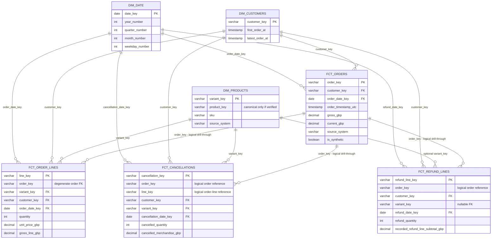

# Phase 6 — Redshift dimensional warehouse ERD

This is the *logical star schema* implemented by dbt in Redshift. GitHub renders the Mermaid chart below. Source tables are already populated in `silver_staging`; dbt creates views in `analytics_staging` and physical dimensions/facts in `analytics_marts`. Do not mistake these for an executed dbt build until a runtime has been deployed and verified.



## Fact grains and correctness

| Fact table | Grain | Source | Meaning |
| --- | --- | --- | --- |
| `fct_orders` | One source-qualified order | 14,110 historical and 196 latest Shopify orders on the 20-Nov checkpoint | Order count and latest reported order-level value, **not settled cash** |
| `fct_order_lines` | One source-qualified item line | Synthetic order items and Shopify order lines | Item quantity and merchandise value |
| `fct_cancellations` | One simulated cancellation event | Historical synthetic cancellation ledger | Simulated cancellation quantity/amount, **not verified refund** |
| `fct_refund_lines` | One Shopify refund line, when present | Shopify refund + refund-line Silver tables | Recorded refund-line amount; **not payment-settlement evidence** |

Dimension keys are deterministic, source-qualified warehouse business keys. Redshift does not enforce conventional primary/foreign keys; dbt `unique`, `not_null` and `relationships` tests are the correctness controls. `dim_products` deliberately never merges historical variants with Shopify SKUs until the verified product-identity mapping reaches Silver.

Do not join facts by `customer_key` or `order_date_key` and then aggregate both: that multiplies rows at different grains. Fact-to-fact links in this ERD are *logical order drill-through references*, not instructions for an unconstrained star join.

## Warehouse layout

```text
analytics (Redshift database)
├── silver_staging         <- persisted and reconciled Glue Silver (existing)
├── analytics_staging      <- dbt views over Silver
└── analytics_marts        <- dbt tables:
    ├── dim_date
    ├── dim_customers
    ├── dim_products
    ├── fct_orders
    ├── fct_order_lines
    ├── fct_cancellations
    └── fct_refund_lines
```

Daily aggregation and churn-feature models already exist but remain separate from the acceptance of the conformed dimensional core. Future Redshift analytics and ML should only start after a clean, runtime-executed `dbt build` and verified source freshness.

## Controlled deployment sequence

1. Ensure the `silver_staging` loader has committed the current manifest into `warehouse_load_ledger`.
2. Provision `analytics_staging` and `analytics_marts` schemas with the verified dbt runtime database identity. Confirm that role has read/usage privileges on `silver_staging` and create/write privileges on the two target schemas. Do not grant `PUBLIC` broad permissions.
3. Configure the dbt Redshift adapter using a private network path and short-lived credentials, not an embedded permanent password.
4. Run `dbt parse` (offline), then a reviewed `dbt build --select +fct_refund_lines +fct_cancellations` to materialize all seven core tables and their dependencies. Check relationships, uniqueness, non-null keys, known historical counts, latest Shopify minimums and ledger integrity.
5. Only after this succeeds, execute `dbt build` for the aggregation and churn-feature models, followed by a business-metric review. Do not train churn on `current_gbp` at historical as-of times without event-time snapshots.

This file is architecture documentation, **not** an assertion that dbt has already run in Redshift.
