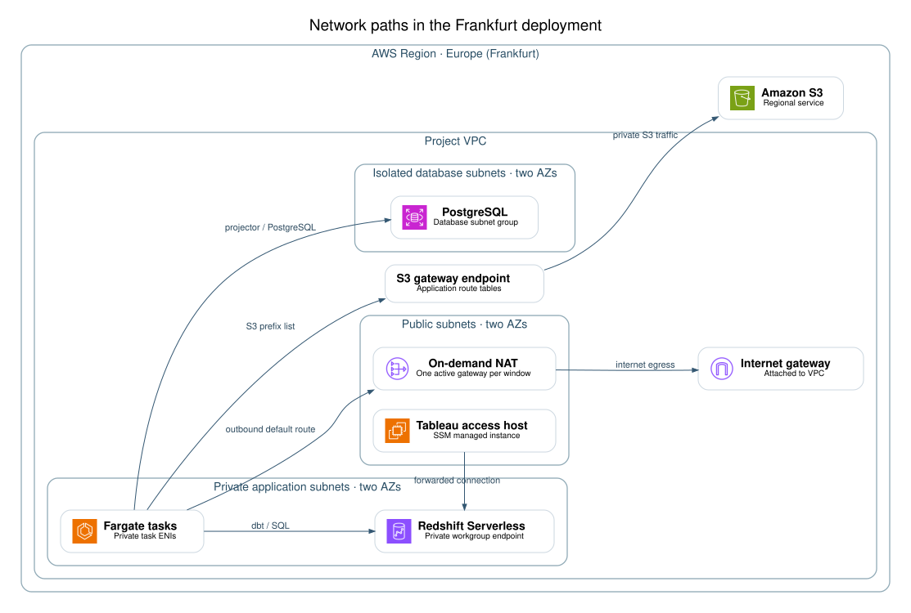
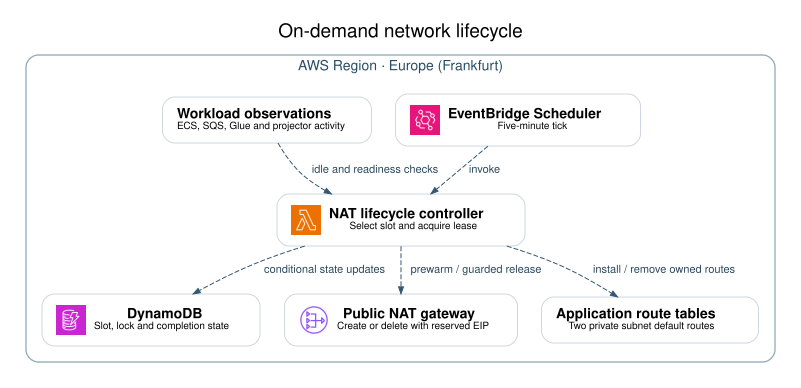

# Architecture and decisions

There are **two systems working together**:

- **Operational system:** receives Shopify notifications, holds them durably, and updates the authoritative order/refund records in PostgreSQL. It must handle duplicate and out-of-order deliveries.
- **Analytical system:** extracts a verified processing batch, loads Redshift, and rebuilds consistent dbt reporting models. It must explain *which* data a report contains and whether that data passed validation.

They are deliberately separated. A fast webhook acknowledgement is useful for Shopify, but it is **not proof of an updated sales report**.

A second deliberate boundary is network cost: application tasks and the database run privately, while a controller creates outbound NAT networking only when required. This is a cost-conscious portfolio design with trade-offs in startup latency and cross-AZ dependency, not a claim of production high availability.

**How to read the diagrams:** Start with the [system overview](diagrams/exports/overview.svg), then use the network diagram below to understand *where* workloads run. Follow the [pipeline walkthrough](../pipelines/README.md) for *when* data moves, and the [data models](../data-model/README.md) for *what* each stage stores.

## Deployment and routing

The project runs in a dedicated environment in Europe (Frankfurt), across two Availability Zones. The account identifier and physical subnet IDs are unnecessary for understanding the design. Each subnet tier has a distinct routing purpose.

| Tier | Placement and route | Consequence |
| --- | --- | --- |
| Public pair | Internet gateway default route. One on-demand public NAT gateway uses a reserved Elastic IP. The Tableau access host has its own security group. | Public IPv4 assignment is explicit. The access stack requests one for the host and uses an outbound SSM session. |
| Private application pair | ECS task ENIs, Glue JDBC connection and private Redshift workgroup connectivity. Both route tables reach S3 via its gateway endpoint. | S3 remains reachable between NAT windows. During a window both default routes point to the same available NAT. |
| Isolated database pair | Private RDS PostgreSQL subnet group with local VPC routing. | Projector and Glue connect through permitted security-group paths. Database traffic stays inside the VPC. |

API Gateway, queues, DynamoDB, S3 and the orchestration services are regional services. The network diagram places the clients and private connection points inside the VPC. The public webhook entrypoint stays available independently of application subnet internet routing.

## Architectural decisions

| Choice | Reason | Operational consequence |
| --- | --- | --- |
| Queue before projection | Shopify can deliver while RDS is stopped. | An acknowledgement alone cannot prove a report contains the order. Queue age and pending event state measure different backlogs. |
| S3 payload plus DynamoDB index | Retain replayable payloads and allow workers to find pending work without scanning the archive. | A checksum connects the index to object bytes. Recovery must preserve both the event identity and the database ledger. |
| PostgreSQL for operations, Redshift for analytics | Order updates require constraints and transactions. Reporting combines facts across sources and grains. | Glue establishes a quiescent extraction boundary. Full JDBC reads across tables do not provide a shared transaction snapshot. |
| Manifest-based warehouse publication | The loader can distinguish a complete batch from partially written objects. | The five Shopify staging tables refresh together. Historical synthetic tables have a separate load path. |
| Private dbt task and SQL churn model | SQL transformations, tests and scoring can run against the existing warehouse. | dbt refreshes features. Refitting the persisted classifier parameters is a separate SQL operation. |
| Shared, on-demand NAT | Concentrate public egress into predictable processing windows. | Creation takes time, one gateway serves both AZs and a premature release can strand a task. The controller checks both routes and outstanding work. |

## Ownership and evidence

Terraform owns the network foundation, operational service resources, Glue, Redshift and the NAT controller. The controller owns the ephemeral gateway and its application default routes. CloudFormation owns the coordinator, Silver loader, dbt orchestrator and Tableau access stacks and their child resources. 

[Network definitions](../../infrastructure/terraform/networking.tf) · [NAT controller](../../scripts/aws/phase6_nat_lifecycle_lambda.py) · [Stack templates](../../infrastructure/cloudformation) · [Diagram sources and rendering](diagrams/README.md)
