# Deployed architecture | RealtimeEcommerceAnalytics

Updated **2026-11-21**. Earlier Databricks/Kinesis descriptions in this directory were proposals and **do not reflect the deployed AWS stack**.

## Operational ingestion and warehouse

```mermaid
flowchart LR
  scheduler[EventBridge Scheduler] --> generator[ECS scheduled Shopify generator]
  nat[On-demand NAT 07:30 and 15:30 Europe/Berlin] -. outbound access .-> generator
  generator --> shopify[Shopify synthetic order store]
  shopify --> api[HTTPS webhook FastAPI / ALB]
  api --> rds[RDS PostgreSQL inbox / operational projection]
  api --> sqs[SQS event queue with DLQ]
  sqs --> landing[Lambda landing]
  landing --> bronze[S3 raw and warehouse snapshot data]
  rds --> export[S3 operational exports]
  export --> bronze
  bronze --> glue[Glue Silver validation / cleansing]
  historic[S3 verified historical backfill] --> glue
  glue --> loader[Redshift loader]
  loader --> staging[Redshift analytics_staging]
  staging --> dbt[dbt ECS transformations and tests]
  dbt --> marts[Redshift analytics_marts]
  marts --> churn[Redshift analytics_ml SQL churn classifier]
  churn --> bi[Redshift analytics_bi curated read-only views]
  marts --> bi
  bi -. private Redshift TCP 5439 .-> access[Private network access, not provisioned]
  access -.-> tableau[Tableau Desktop / Tableau Bridge]
```

The physical private Tableau network access path is **not deployed**. Current Redshift workgroup `ecommerce-analytics-demo` is private (`publiclyAccessible=false`), VPC `vpc-076127eb4c8bb7437`, port `5439`, security group `sg-0a2af03c0dda1e8fc`. It currently only permits inbound TCP 5439 from the dbt ECS security group `sg-0d06aade34183743b`.

Operational notes: ECS generator at **08:00 and 16:00 Europe/Berlin**, scheduled on-demand NAT prewarm at **07:30 and 15:30**, evening lifecycle at **22:00**. Database is allowed to stop between batches. Both application private route tables preserve S3 gateway endpoint routes during NAT off periods. Verify first end-to-end dynamic NAT warm/teardown cycle independently.

## SQL churn and Tableau BI

`analytics_marts.mart_customer_churn_training` and `analytics_marts.mart_customer_churn_scoring` feed a simple SQL-trained Naive Bayes baseline in `analytics_ml`. Seven Tableau-facing views are deployed in the distinct `analytics_bi` schema:

- `v_churn_model_metrics` — holdout classification metrics
- `v_churn_risk_segments` — current customer risk buckets
- `v_churn_monthly_labels` — observed label distribution by customer-month
- `v_churn_model_calibration` — prediction decile calibration
- `v_churn_risk_by_recency` — segments by most recent order
- `v_customer_churn_scores` — pseudonymous customer-level scores
- `v_monthly_sales` — sales month, order source and net GBP

A database role `tableau_analytics_reader` exists with `USAGE` on `analytics_bi` and `SELECT` on its seven current views and its future tables/views. **No database login identity has yet been mapped to that role, and Tableau is not live-connected.** Never connect Tableau as the Redshift administrator.

SQL installation/reproducibility: `scripts/redshift/tableau_bi_views.sql`; churn training: `scripts/redshift/train_churn_naive_bayes.sql`. SQL model is a learning baseline on synthetic data, ROC-AUC about **0.640**; do not interpret its churn scores as calibrated probabilities for real customer interventions.

## Tableau connection design options

**Recommended first integration (Tableau Desktop Free):** Install Tableau Desktop Free Edition and the AWS Redshift ODBC 2.x driver on Windows. For a live private connection, deploy **only when needed** a small SSM-managed EC2 access instance in an existing public subnet (with outbound internet, **no inbound SSH/RDP**). Use AWS Systems Manager Session Manager local port forwarding to the private Redshift DNS/5439, then open Tableau to `localhost:15439` with required TLS and read-only login. For correctness, ensure the ODBC connector supports the loopback endpoint without TLS hostname-verification failures; production clients should use a trusted hostname. The SSM instance and SG rules **have not been provisioned** and incur EC2/EBS/public-IP costs if deployed. Provision with Terraform, restricted IAM StartSession, and explicit session start/stop, avoiding new always-on NAT/VPN charges.

**Future enterprise publishing (Tableau Cloud):** A Tableau Bridge agent with network access to the VPC, or Tableau Cloud Outbound Private Connect for Redshift, provides a secure private path. Bridge itself has no extra license fee beyond a qualifying Tableau Cloud site, but running the agent and cloud licensing may incur cost. A Bridge client on a laptop without private VPC connectivity **cannot** access the warehouse. Keep the workgroup private; do not temporarily publish Redshift to `0.0.0.0/0` as a shortcut. Tableau Desktop Free Edition can connect live locally but **cannot publish to Tableau Cloud or Server**.

Connection parameters for **Tableau native Amazon Redshift connector** once the network path and read-only database identity are configured:

| Setting | Value |
| --- | --- |
| Hostname | `ecommerce-analytics-demo.825414820081.eu-central-1.redshift-serverless.amazonaws.com` inside VPC, or tunneled `localhost` with local port |
| Port | `5439` native; `15439` for proposed local tunnel |
| Database | `analytics` |
| Schema | `analytics_bi` |
| Role | `tableau_analytics_reader` (must assign to Tableau login) |
| SSL | Required |

Before declaring Tableau integrated: provision/verify private path, establish a least-privilege login, test native Redshift connection and query, build or repoint dashboard, and confirm refresh. Never store live credentials in GitHub or a packaged workbook.

## Application design note

The domain/application boundaries in original application code are a separate concern from AWS infrastructure; preserve domain decoupling when refactoring. Do not describe the deployed runtime as Databricks, Kinesis or Kubernetes without checking the actual current deployment.
