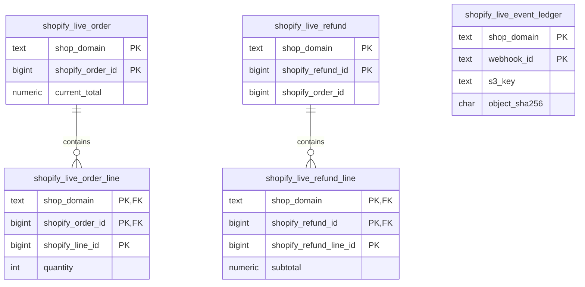
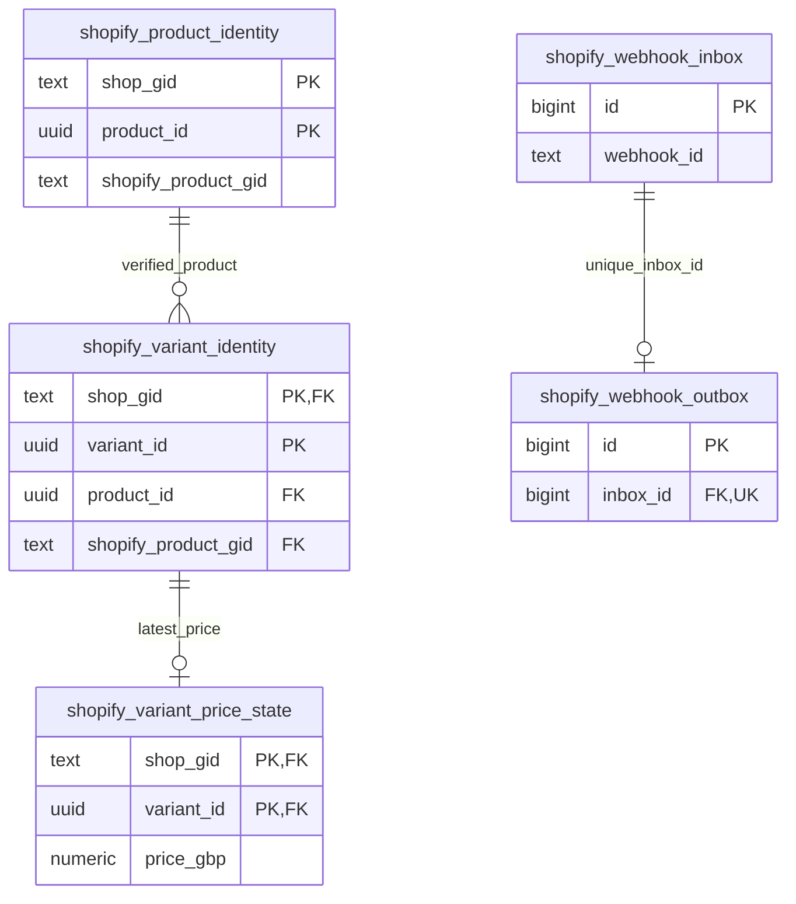
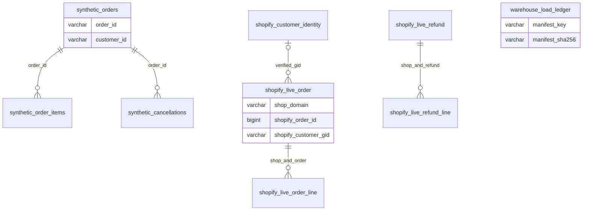
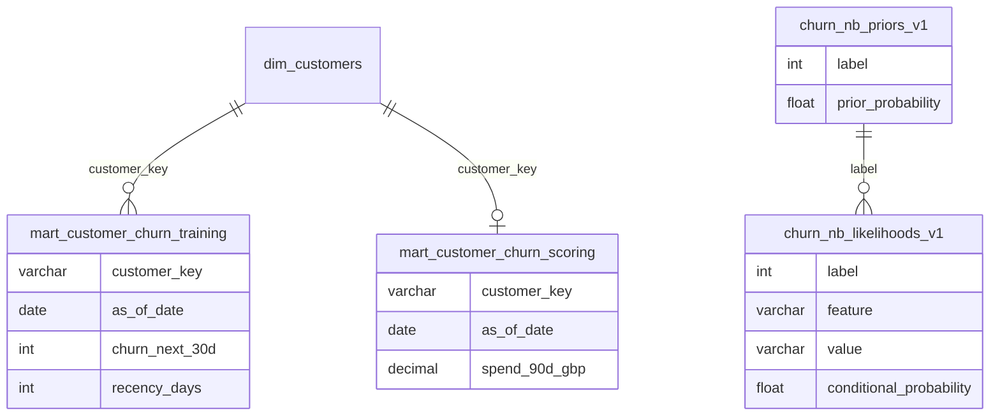

# Keys, grains and lineage

## Operational PostgreSQL

Migrations 001–008 define identities, sync attempts and leases, catalog and price verification, webhook bookkeeping and operational projections. In this diagram repeated PK attributes form one composite key. Solid relationships represent declared foreign keys. The refund header's order ID is a reconciliation reference. Its corresponding order can arrive later.

The simulation run table records expected and completed order counts by run. Customer sync identity, attempts and leases share shop/customer identifiers with separate lifetimes. The catalog holds a product-to-variants FK and a price-state-to-variant FK. The webhook inbox/outbox migration defines a unique outbox reference to an inbox ID. Current ingress acknowledges SQS acceptance and can operate while RDS is stopped. See the [migrations](../../infrastructure/sql) and [identity foundation](../../README_IMPLEMENTATION.md).

### Identity and price constraints

## Redshift staging

The five live Shopify tables enter as one replaceable snapshot. Synthetic order, item and cancellation records come from the historical backfill. The manifest ledger identifies committed loads by key and digest. It provides batch lineage without a row-level foreign key to every business record. The relationships below describe business-key joins. Redshift correctness is checked by loader validation and dbt tests.

The two staging views normalize historical and Shopify order rows. The Shopify view checks the verified customer mapping and filters GBP. The facts use source-qualified order and line keys. The analytical core comprises three dimensions and four facts in the marts schema. The branch defines no separate physical core schema. See the [landing DDL](../../analytics/redshift/silver_staging_schema.sql), [staging views](../../analytics/dbt/models/staging) and [analytical marts ERD](../../analytics/dbt/STAR_SCHEMA_ERD.md).

## Reading the marts

| Dataset | Grain | Meaning |
| --- | --- | --- |
| fct_orders | Source-qualified order | Count orders here. Gross and current GBP values describe the order state. |
| fct_order_lines | Source-qualified order line | Quantity and gross line value support product analysis. Joining back to orders repeats the header amount per line. |
| fct_cancellations | Simulated cancellation event | Cancelled merchandise is a synthetic outcome. |
| fct_refund_lines | Shopify refund line | Recorded line subtotal is evidence of a refund record. Cash settlement requires additional evidence. |
| mart_daily_sales | Order date, source system, synthetic flag | Aggregates gross/current order values and order count. Simulated cancellations join by cancellation date to synthetic rows. Dates without a matching order group do not appear through that join. |

## Customer-month features and parameter tables

Training examples require earlier orders and a fully observable next 30 days. The label is 1 when the customer places zero orders in that half-open future window. Predictors use prior orders for recency, 90-day order count and GBP spend, and lifetime order count. Current scoring uses the day after the latest observed order as its as-of date. Mutable current order totals can limit historical point-in-time fidelity.

These are logical grains. Training is unique by customer and as-of date. Current scoring yields one row per eligible customer. The likelihood table has one row per class, feature and bin. The prediction view evaluates both candidate classes and emits customer, as-of date, cohort, probability and predicted label. Validation rows have observed labels. Current rows have none. The September–October temporal holdout recorded ROC-AUC 0.6398. Calibration and provenance limit how the scores can be interpreted.

[Fact and mart SQL](../../analytics/dbt/models/marts) · [Model fit and scoring SQL](../../scripts/redshift/train_churn_naive_bayes.sql) · [Evaluation and limitations](../churn_sql_model_v1.md)
