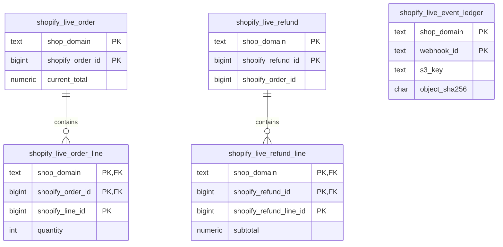
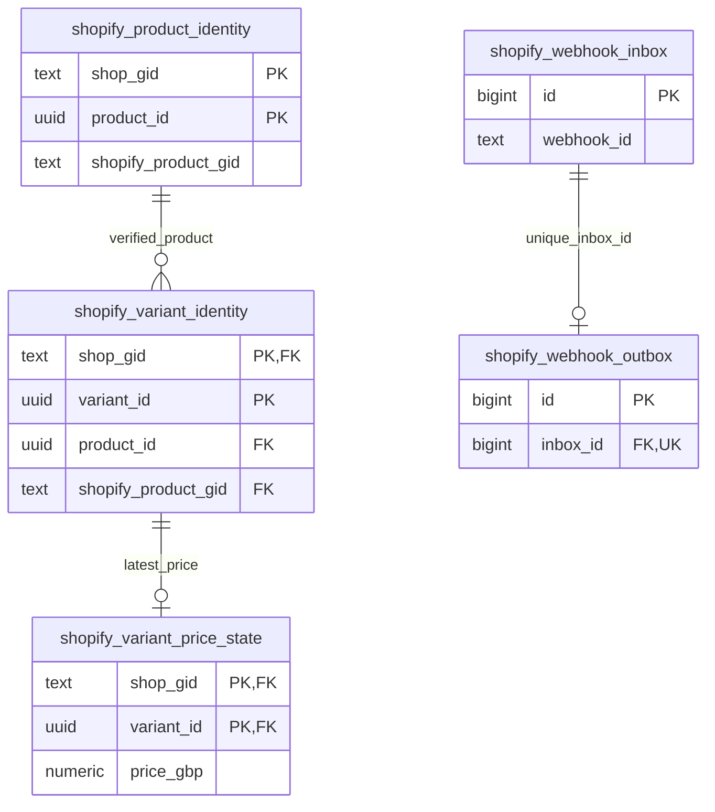
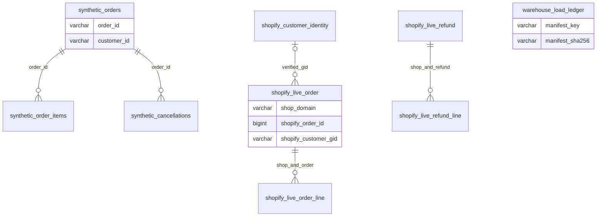
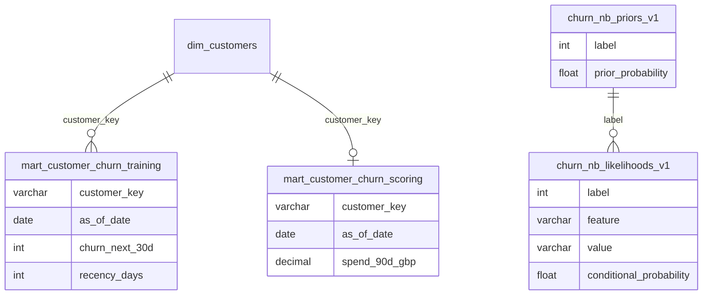

# Data model

[Analytical star schema](#analytical-star-schema) · [PostgreSQL](#operational-postgresql) · [Silver contract](#live-shopify-silver-contract)

## Analytical star schema

The analytical star schema in `analytics_marts` comprises three shared dimension tables and four fact tables. The dimensions describe dates, customers and products. The facts record orders, order lines, simulated cancellations and Shopify refund lines. Each fact has its own grain and relates to the dimensions applicable to that event. PK and FK labels identify logical keys checked by dbt.


Each date link has a business meaning. For instance, comparing orders and cancellations by calendar date counts purchases on their order date and cancellations on their cancellation date. To analyze cancellations by the **original purchase date**, look up the order by its order key first.

| Dimension | What one row represents | Key rule |
| --- | --- | --- |
| `dim_date` | One calendar day from 2026 through 2040 | Match the date key for the event being measured. |
| `dim_customers` | One canonical customer, including known customers with no purchases | The live staging view resolves verified Shopify customer IDs to canonical IDs. |
| `dim_products` | One source-qualified variant | Historical variants retain canonical IDs. Live variants use shop-scoped keys, with a line-scoped fallback for a missing variant ID. A shared SKU alone does not establish identity across sources. |

The historical order key uses `synthetic_2026:<order_id>`. Shopify keys include the shop domain and source ID. To inspect the currently visible mart columns in a read-only warehouse session:

```sql
SELECT table_name, column_name, data_type
FROM information_schema.columns
WHERE table_schema = 'analytics_marts'
ORDER BY table_name, ordinal_position;
```

### Fact grains

| Dataset | Grain | Meaning |
| --- | --- | --- |
| fct_orders | Source-qualified order | Count orders here. Gross and current GBP values describe the order state. |
| fct_order_lines | Source-qualified order line | Quantity and gross line value support product analysis. Joining back to orders repeats the header amount per line. |
| fct_cancellations | Simulated cancellation event | Cancelled merchandise is a synthetic outcome. |
| fct_refund_lines | Shopify refund line | Recorded line subtotal is evidence of a refund record. Cash settlement requires additional evidence. |

### Order and line drill-through

The model also retains references between event rows. These are useful when looking up one order or reconciling adjustments. Joining several facts on a customer or date before summing measures can multiply the amounts.

| From | Lookup | Key and coverage |
| --- | --- | --- |
| Order line | Order | `order_key`, tested for a match |
| Cancellation | Order and original line | `order_key` and `line_key`, both tested |
| Refund line | Order | `order_key`, tested for a match |
| Refund line | Original line | `line_key` when available. The SQL left join can leave `variant_key` empty. |

PostgreSQL accepts a refund before its order arrives. The analytical contract is stricter: dbt tests require a matching order and customer on refund lines. Only the product relationship is optional there. See the [relationship tests](../../analytics/dbt/models/marts/_schema.yml) and [refund model](../../analytics/dbt/models/marts/fct_refund_lines.sql).

## Historical Silver contract

Online Retail II supplies the customer and catalog identities used by the synthetic backfill and Shopify simulation. Historical Silver is a versioned set of Parquet datasets. The [live Shopify Silver contract](#live-shopify-silver-contract) covers a different input: operational records extracted from PostgreSQL.

### From a workbook row to a canonical entity

Bronze keeps the original workbook, its checksum, and the worksheet name and row position for each source record. The source invoice timestamp has no timezone and the workbook has no explicit currency. Historical Silver preserves those limits. Generated UTC event times and simulated GBP prices belong to the backfill.

| Historical dataset | Grain and key | Source identity retained |
| --- | --- | --- |
| `customers` | One identifiable customer per `customer_id` | Normalize the original customer ID to an integer-like string, such as `17850`. Preserve the source system, first-seen timestamp and historical origin. |
| `products` | One stock code per `product_id` | Keep the source stock code, description and item classification. |
| `product_variants` | One canonical variant per `variant_id` | The historical variant derives from the stock code, carries its parent product ID and uses the stock code as its SKU. |
| `orders` | One invoice per `order_id` | Keep the original invoice identifier, including cancellation identifiers. The transform rejects invoices assigned to multiple customers. |
| `order_items` | One retained source row per `order_item_id` | The worksheet and row position identify the line. Two genuine lines on the same invoice can have identical contents and still have distinct keys. |

The platform uses UUIDv5 with a fixed project namespace, entity type, source system and source key. Reprocessing the same input yields the same ID. A Shopify GraphQL ID identifies a particular Shopify object. The historical transform leaves Shopify IDs empty. Synchronization records the IDs returned by Shopify and verifies customer, product and variant mappings within the shop. A Shopify-bound order requires the verified **variant** for each item. The full historical synchronization population is 5,942 identifiable customers for the reference workbook.

### Reconciliation and provenance

Every Bronze row falls into exactly one count: a removed cross-sheet copy, a quarantined row missing its customer ID, or a retained customer-linked line. The transform publishes `cross_sheet_duplicates` and `quarantine` so the first two counts remain auditable. It also publishes `returns_adjustments` as a subset of retained lines. Adding this subset to the reconciliation total would count those lines twice.

Historical prices and signed line amounts use decimal arithmetic. Before publication, the transform checks order and line key uniqueness, verifies the order and customer references, and reconciles the source population. The Silver manifest is written last and links the output files to the verified Bronze input.

The deterministic backfill uses Silver-derived profiles over an explicit UTC interval with an inclusive start and exclusive end. Batch and event identifiers trace generated records back to a run. An order generated in the development store keeps its synthetic provenance when delivered through a genuine Shopify webhook.

[Historical transformation](../../src/ecommerce/pipelines/silver/historical.py) · [Canonical ID definitions](../../src/ecommerce/domain/identifiers.py) · [Synthetic backfill](../../src/ecommerce/application/use_cases/synthetic_backfill.py)

## Operational PostgreSQL

Migrations 001–008 define identities, sync attempts and leases, catalog and price verification, webhook bookkeeping and operational projections. In this diagram repeated PK attributes form one composite key. Solid relationships represent declared foreign keys. The refund header's order ID is a reconciliation reference. Its corresponding order can arrive later.



The simulation run table records expected and completed order counts by run. Customer sync identity, attempts and leases share shop/customer identifiers with separate lifetimes. The catalog holds a product-to-variants FK and a price-state-to-variant FK. The webhook inbox/outbox migration defines a unique outbox reference to an inbox ID. Current ingress acknowledges SQS acceptance and can operate while RDS is stopped. See the [migrations](../../infrastructure/sql).

### Identity and price constraints



## Redshift staging

The five live Shopify tables enter as one replaceable snapshot. Synthetic order, item and cancellation records come from the historical backfill. The manifest ledger identifies committed loads by key and digest. It provides batch lineage without a row-level foreign key to every business record. The relationships below describe business-key joins. Redshift correctness is checked by loader validation and dbt tests.



Within database `analytics`, `silver_staging` holds loaded sources. `analytics_staging` holds dbt views, `analytics_marts` holds the dimensional and feature tables, `analytics_ml` holds model parameters, predictions and reporting views.

The two staging views normalize historical and Shopify order rows. The Shopify view checks the verified customer mapping and filters GBP. The facts use source-qualified order and line keys. The analytical core comprises three dimensions and four facts in the marts schema. The branch defines no separate physical core schema. See the [landing DDL](../../analytics/redshift/silver_staging_schema.sql), [staging views](../../analytics/dbt/models/staging) and [analytical star schema](#analytical-star-schema).

### Live Shopify Silver contract

Glue publishes each live table under the same name used by Redshift in `silver_staging`. Match the column order and warehouse types before changing extraction or COPY.

| Spark Silver table | Redshift silver_staging target | Columns | Matching data types |
| --- | --- | ---: | --- |
| shopify_live_order | shopify_live_order | 13 | string/VARCHAR, long/BIGINT, timestamp/TIMESTAMPTZ, DECIMAL(18,2), boolean |
| shopify_live_order_line | shopify_live_order_line | 9 | string/VARCHAR, long/BIGINT, int/INT, DECIMAL(18,2), timestamp |
| shopify_live_refund | shopify_live_refund | 6 | string/VARCHAR, long/BIGINT, DECIMAL(18,2), timestamp |
| shopify_live_refund_line | shopify_live_refund_line | 6 | string/VARCHAR, long/BIGINT, int/INT, DECIMAL(18,2) |
| shopify_customer_identity | shopify_customer_identity | 7 | string/VARCHAR, timestamp |

Keep UTC timestamps, exact decimal money, bounded text lengths and source-specific composite keys. Quarantine invalid identifiers and unresolved customer mappings. Preserve Shopify variant identity until a verified canonical mapping is available. The [staging DDL](../../analytics/redshift/silver_staging_schema.sql) defines the full column order.

## Sales aggregation

`analytics_marts.mart_daily_sales` groups orders by order date, source system and synthetic flag. It sums order counts and gross and current GBP values. Simulated cancellations join by cancellation date to synthetic order groups, so a cancellation date with no matching order group contributes no row.

## Customer-month features

The two feature marts and the SQL parameter tables have different grains. See [Sales and retention](../sales-retention-and-validation.md) for the target, cutoff and evaluation.



These are logical grains. Training is unique by customer and as-of date. Current scoring yields one row per eligible customer. The likelihood table has one row per class, feature and bin. The prediction view evaluates both candidate classes and emits customer, as-of date, cohort, probability and predicted label. Validation rows have observed labels. Current rows have none.

[Fact and mart SQL](../../analytics/dbt/models/marts) · [Model fit and scoring SQL](../../scripts/redshift/train_churn_naive_bayes.sql) · [Evaluation and limitations](../sales-retention-and-validation.md#reproduce-the-evaluation)


## Reporting views

Redshift exposes the reporting objects below in `analytics_ml`. The working Tableau workbook connects directly to the seven fact and dimension tables through one data source. Its second data source uses Custom SQL. The catalog and workbook were checked on November 25, 2026.

| View in `analytics_ml` | Grain or filter | Use in the workbook SQL |
| --- | --- | --- |
| `tableau_lb_v_monthly_sales` | Month of order and source system | Sales, growth and reconciliation with daily and order-level totals |
| `tableau_lb_v_customer_churn_scores` | Current prediction joined to features by customer and cutoff date | Latest-cutoff risk distribution and customer shortlist |
| `churn_nb_predictions_v1` | Customer, cutoff and cohort | Calibration deciles derived from the validation cohort |
| `churn_nb_validation_metrics_v1` | One aggregate over validation predictions | Model precision, recall and ROC-AUC |
| `tableau_lb_v_churn_risk_by_recency` | Recency band among current predictions | Available for SQL analysis |
| `churn_nb_score_segments_v1` | Risk segment among current predictions | Available for SQL analysis |
| `churn_features_v1` | Labeled customer-month with binned features | Upstream input to scoring and evaluation |

[Reporting examples and metric definitions](../sales-retention-and-validation.md) · [View definitions](../../scripts/redshift/tableau_bi_views.sql)
