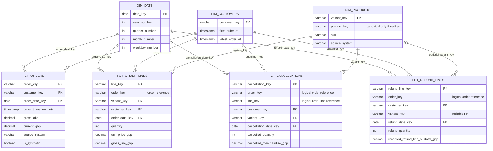
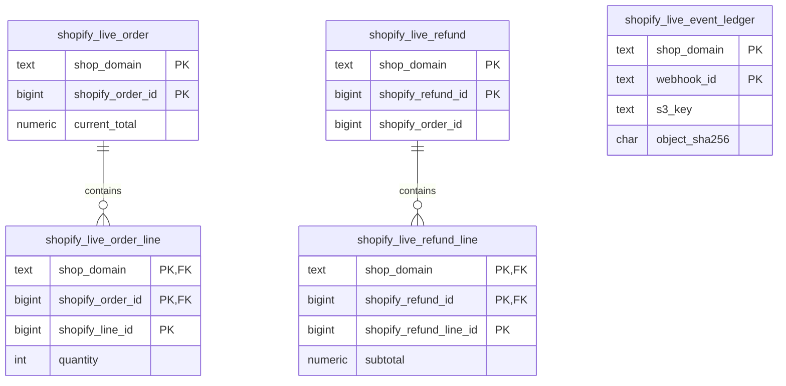
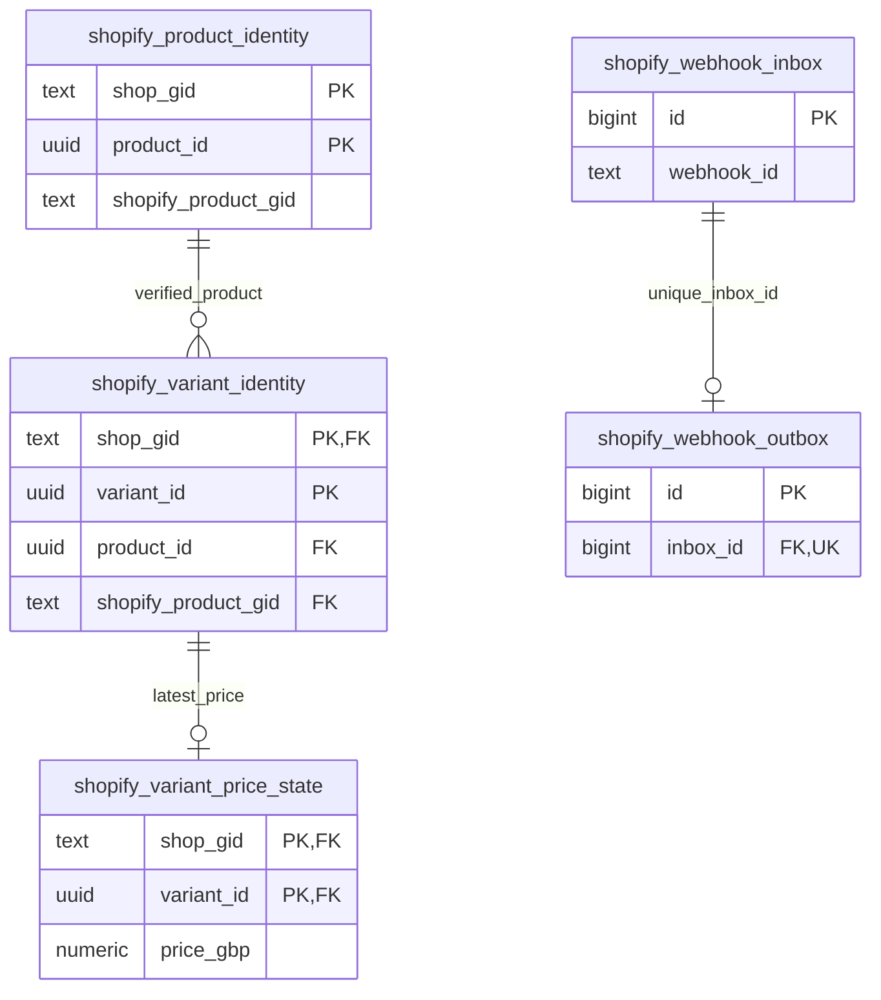
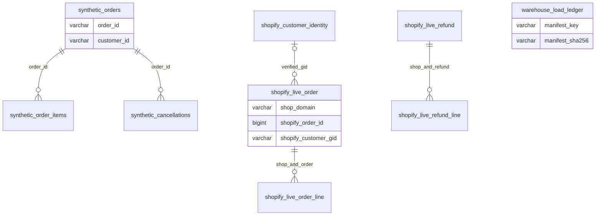
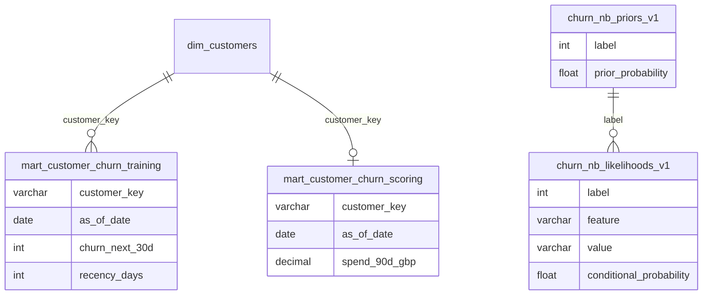

# Data model

[Analytical star schema](#analytical-star-schema) · [Building relationships in Tableau](#building-relationships-in-tableau) · [PostgreSQL](#operational-postgresql) · [Silver contract](#live-shopify-silver-contract)

## Analytical star schema

The [November 21 Redshift handoff](https://app.notion.com/p/41f929a22c1581279669d9dca31d0e2d) recorded ten accessible tables in `analytics_marts` and seven curated BI views. The [dbt definitions](../../analytics/dbt/models/marts) identify the ten tables as three dimensions, four event facts, daily sales and two customer churn feature marts. The diagram shows the seven dimensional tables. PK and FK labels here describe logical keys checked by dbt. They do not establish database-enforced constraints or automatically create Tableau relationships.



Each date link has a business meaning. For instance, comparing orders and cancellations by calendar date counts purchases on their order date and cancellations on their cancellation date. To analyze cancellations by the **original purchase date**, look up the order by its order key first.

| Dimension | What one row represents | Key rule |
| --- | --- | --- |
| `dim_date` | One calendar day from 2026 through 2040 | Match the date key for the event being measured. |
| `dim_customers` | One canonical customer, including known customers with no purchases | The live staging view resolves verified Shopify customer IDs to canonical IDs. |
| `dim_products` | One source-qualified variant | Historical variants retain canonical IDs. Live variants use shop-scoped keys, with a line-scoped fallback for a missing variant ID. A shared SKU alone does not establish identity across sources. |

The historical order key uses `synthetic_2026:<order_id>`. Shopify keys include the shop domain and source ID. To inspect the currently visible mart columns in a read-only warehouse session:

```sql
SELECT table_name, column_name, data_type
FROM information_schema.columns
WHERE table_schema = 'analytics_marts'
ORDER BY table_name, ordinal_position;
```

### Order and line drill-through

The model also retains references between event rows. These are useful when looking up one order or reconciling adjustments. Joining several facts on a customer or date before summing measures can multiply the amounts.

| From | Lookup | Key and coverage |
| --- | --- | --- |
| Order line | Order | `order_key`, tested for a match |
| Cancellation | Order and original line | `order_key` and `line_key`, both tested |
| Refund line | Order | `order_key`, tested for a match |
| Refund line | Original line | `line_key` when available. The SQL left join can leave `variant_key` empty. |

PostgreSQL accepts a refund before its order arrives. The analytical contract is stricter: dbt tests require a matching order and customer on refund lines. Only the product relationship is optional there. See the [relationship tests](../../analytics/dbt/models/marts/_schema.yml) and [refund model](../../analytics/dbt/models/marts/fct_refund_lines.sql).

## Building relationships in Tableau

In the working workbook, choose **Data → New Data Source**, connect to the private Redshift database and select `analytics_marts`. Keep the existing dashboard source for existing sheets. A CSV, a serving view or one Custom SQL query appears as a single logical table. Hiding or unhiding sheets does not expose the tables that produced it.

1. Start with one question, such as **which products contributed merchandise value each month?** Drag `fct_order_lines` onto the top-level logical canvas. Drag each of the following dimensions beside it and select the equality fields.

   | Dimension | Dimension field | Order-line field |
   | --- | --- | --- |
   | `dim_date` | `date_key` | `order_date_key` |
   | `dim_products` | `variant_key` | `variant_key` |
   | `dim_customers` | `customer_key` | `customer_key` |

2. Create a worksheet using the new source. Put month of `date_key` on Columns and `SUM(gross_line_gbp)` on Rows. Check the total against the same date/source slice of `fct_order_lines` before adding product detail. Double-clicking a logical table opens the physical join layer. Return to the top-level canvas to add a relationship.
3. For order value alongside line value, Tableau 2024.2 and later supports another **base table**. Drag `fct_orders` into the **New Base Table** drop area and use the same date and customer dimensions as shared tables. Build the comparison with fields from those shared dimensions. Product detail applies to lines; an order header has no product key. Leave order-to-line drill-through off this canvas. On earlier versions, use separate single-fact sources or a serving view at the required grain.
4. If a refund can lack a variant, retain **Some records match** for that relationship. Keep the default performance settings until uniqueness and coverage have been checked in the reporting slice.

[Tableau data model](https://help.tableau.com/current/pro/desktop/en-us/datasource_datamodel.htm) · [Private Redshift connection](../operations/README.md#connect-tableau-to-private-redshift)

## Operational PostgreSQL

Migrations 001–008 define identities, sync attempts and leases, catalog and price verification, webhook bookkeeping and operational projections. In this diagram repeated PK attributes form one composite key. Solid relationships represent declared foreign keys. The refund header's order ID is a reconciliation reference. Its corresponding order can arrive later.



The simulation run table records expected and completed order counts by run. Customer sync identity, attempts and leases share shop/customer identifiers with separate lifetimes. The catalog holds a product-to-variants FK and a price-state-to-variant FK. The webhook inbox/outbox migration defines a unique outbox reference to an inbox ID. Current ingress acknowledges SQS acceptance and can operate while RDS is stopped. See the [migrations](../../infrastructure/sql).

### Identity and price constraints



## Redshift staging

The five live Shopify tables enter as one replaceable snapshot. Synthetic order, item and cancellation records come from the historical backfill. The manifest ledger identifies committed loads by key and digest. It provides batch lineage without a row-level foreign key to every business record. The relationships below describe business-key joins. Redshift correctness is checked by loader validation and dbt tests.



Within database `analytics`, `silver_staging` holds loaded sources. `analytics_staging` holds dbt views, `analytics_marts` holds the dimensional and feature tables, `analytics_ml` serves model parameters and predictions, and `analytics_bi` exposes reporting views.

The two staging views normalize historical and Shopify order rows. The Shopify view checks the verified customer mapping and filters GBP. The facts use source-qualified order and line keys. The analytical core comprises three dimensions and four facts in the marts schema. The branch defines no separate physical core schema. See the [landing DDL](../../analytics/redshift/silver_staging_schema.sql), [staging views](../../analytics/dbt/models/staging) and [analytical star schema](#analytical-star-schema).

### Live Shopify Silver contract

Glue publishes each live table under the same name used by Redshift in `silver_staging`. Match the column order and warehouse types before changing extraction or COPY.

| Spark Silver table | Redshift silver_staging target | Columns | Matching data types |
| --- | --- | ---: | --- |
| shopify_live_order | shopify_live_order | 13 | string/VARCHAR, long/BIGINT, timestamp/TIMESTAMPTZ, DECIMAL(18,2), boolean |
| shopify_live_order_line | shopify_live_order_line | 9 | string/VARCHAR, long/BIGINT, int/INT, DECIMAL(18,2), timestamp |
| shopify_live_refund | shopify_live_refund | 6 | string/VARCHAR, long/BIGINT, DECIMAL(18,2), timestamp |
| shopify_live_refund_line | shopify_live_refund_line | 6 | string/VARCHAR, long/BIGINT, int/INT, DECIMAL(18,2) |
| shopify_customer_identity | shopify_customer_identity | 7 | string/VARCHAR, timestamp |

Keep UTC timestamps, exact decimal money, bounded text lengths and source-specific composite keys. Quarantine invalid identifiers and unresolved customer mappings. Preserve Shopify variant identity until a verified canonical mapping is available. The [staging DDL](../../analytics/redshift/silver_staging_schema.sql) defines the full column order.

## Reading the marts

| Dataset | Grain | Meaning |
| --- | --- | --- |
| fct_orders | Source-qualified order | Count orders here. Gross and current GBP values describe the order state. |
| fct_order_lines | Source-qualified order line | Quantity and gross line value support product analysis. Joining back to orders repeats the header amount per line. |
| fct_cancellations | Simulated cancellation event | Cancelled merchandise is a synthetic outcome. |
| fct_refund_lines | Shopify refund line | Recorded line subtotal is evidence of a refund record. Cash settlement requires additional evidence. |
| mart_daily_sales | Order date, source system, synthetic flag | Aggregates gross/current order values and order count. Simulated cancellations join by cancellation date to synthetic rows. Dates without a matching order group do not appear through that join. |

## Customer-month features and parameter tables

The two feature marts and the SQL parameter tables have different grains. See [Sales and retention](../sales-retention-and-validation.md) for the target, cutoff and evaluation.



These are logical grains. Training is unique by customer and as-of date. Current scoring yields one row per eligible customer. The likelihood table has one row per class, feature and bin. The prediction view evaluates both candidate classes and emits customer, as-of date, cohort, probability and predicted label. Validation rows have observed labels. Current rows have none.

[Fact and mart SQL](../../analytics/dbt/models/marts) · [Model fit and scoring SQL](../../scripts/redshift/train_churn_naive_bayes.sql) · [Evaluation and limitations](../sales-retention-and-validation.md#reproduce-the-evaluation)
