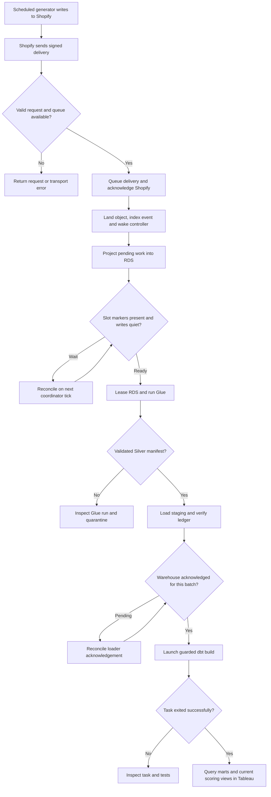
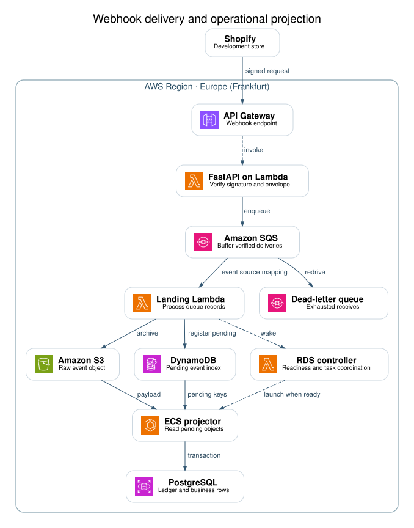
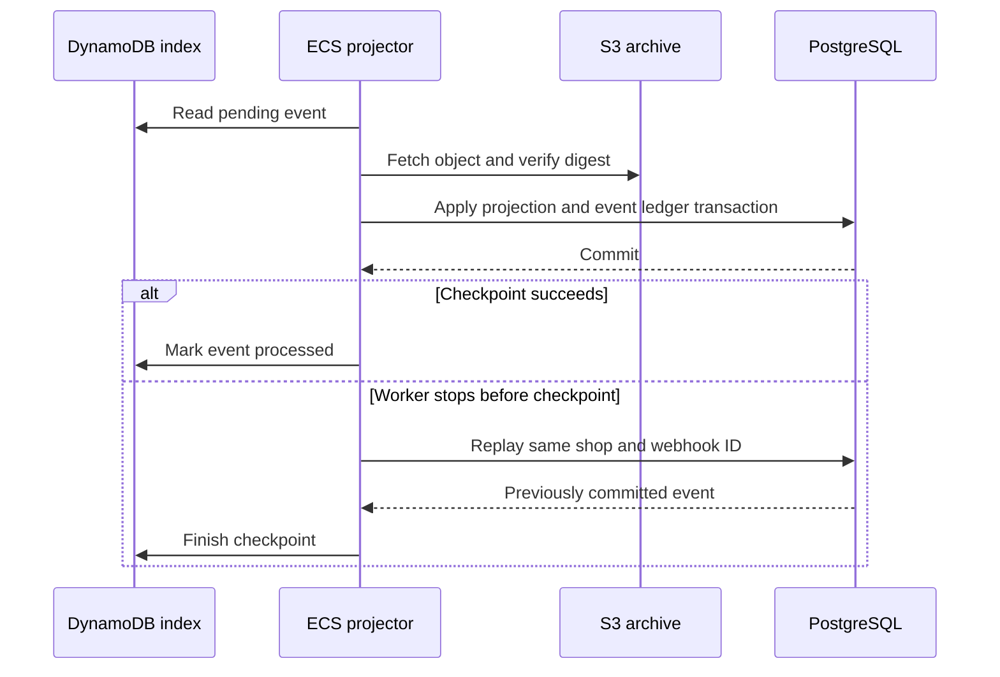
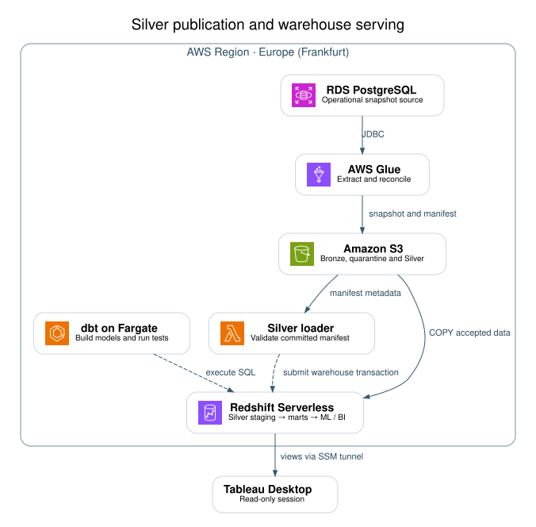

# From a Shopify order to a trustworthy report

**Start with the business story:** a simulated customer places an order in the Shopify development store. Shopify sends a webhook; the platform accepts it even when PostgreSQL is asleep, applies it safely when the database is ready, validates a complete processing batch, and builds reporting tables. A dashboard is considered current only when the downstream checks for that batch complete.

### Five steps to follow

1. **Capture the event:** verify its signature and put the delivery into a durable queue.
2. **Apply the change:** archive the payload, deduplicate it, and update PostgreSQL using a database transaction.
3. **Publish a batch:** wait until the scheduled source work is complete and quiet, then run Glue quality checks.
4. **Build analytics:** load the accepted batch into Redshift and run dbt transformations and tests.
5. **Verify the report:** match the source batch with the warehouse acknowledgement and dbt outcome; then check Tableau's date filters.

**Important:** This is near-real-time *event capture*, not a claim that the warehouse refreshes instantly with every webhook. Operational events and analytical reporting advance on different schedules.

### Terms used in the diagrams

| Term | Meaning in this project |
| --- | --- |
| **Webhook** | An HTTP notification sent by Shopify when an order or refund changes. |
| **Projection** | Applying an event's effect to the current operational tables in PostgreSQL. |
| **Idempotency** | Replaying the same delivery without creating duplicate database effects. |
| **Processing slot** | A scheduled morning or afternoon set of source work, identified by a date and batch marker. |
| **Manifest** | A file describing the objects and checksums that make up one published batch. |
| **Load ledger** | Warehouse record showing which manifest was committed, so retries cannot silently replace it with conflicting data. |
| **Reconciliation** | Checking independently recorded states until the platform can confirm progress or identify a failure. |
| **dbt mart** | A modeled reporting table or view with a stated business grain, such as one row per order or per customer. |

## End-to-end activity

## Generation and lifecycle

All slot times use Europe/Berlin. EventBridge Scheduler starts the generator at 08:00 and 16:00. It uses approved customer and catalog identities and verified GBP prices to create controlled transactions in the development store. The slot runner writes the completion marker only after successful generation. The 16:30 lifecycle task handles simulated cancellations and refunds and publishes a settled marker for the day. If a remote write is ambiguous, inspect its operation journal and read back the Shopify result before repeating a write.

Historical calibration and deterministic backfill are separate inputs. The historical synthetic orders, order items and cancellations enter Silver staging through their historical load path. A live webhook has its own shop, topic, delivery ID and payload. Keep source provenance through aggregation.

[Slot runner](../../scripts/phase5_slot_runner.py) · [Generation](../../scripts/generate_shopify_live_orders.py) · [Lifecycle](../../scripts/run_phase5_lifecycle.py) · [Historical reconciliation](../../scripts/reconcile_synthetic_backfill.py)

## Capture and projection

FastAPI validates request size, HMAC over the original bytes, shop, topic, delivery ID and JSON shape before sending to SQS. Queue unavailability returns HTTP 503. Success means the notification is queued. The SQS event source invokes the landing Lambda. Each record must reach S3, have a DynamoDB pending entry, signal activity and receive an accepted asynchronous controller wake-up. Partial batch responses identify individual failed messages. Repeated receive failures can reach the DLQ.

### A replay across the database commit boundary

The RDS controller waits for database readiness and coordinates the worker. The projector verifies both the pending checksum and S3 object metadata. Order and refund records can arrive out of sequence. The refund reconciliation view exposes missing parents. Inspect failed or conflicting checksums before replaying an object.

[HTTP handler](../../src/ecommerce/interfaces/http/shopify_webhooks.py) · [Landing](../../src/ecommerce/interfaces/workers/shopify_s3_lambda.py) · [Projection](../../src/ecommerce/interfaces/workers/phase5_project_s3.py)

## Slot reconciliation and Glue Silver

The coordinator polls readiness. The morning slot requires its generation marker. The afternoon slot requires both generation markers and the settled lifecycle marker. It also checks recent activity, pending work and worker state. A quiet queue alone could mean generation never happened. The coordinator reserves the slot and a lease, waits for RDS availability and tracks the Glue run ID. Overnight reconciliation can still belong to the previous afternoon's processing day.

Glue reads operational tables over JDBC, writes batch-specific Bronze Parquet, applies schema, identity, monetary and parent-child checks, accounts for rejected records, and publishes Silver gzip JSON Lines plus the completion manifest. Failed quality checks or a missing manifest block publication downstream. Consult the source-to-target contract for the five tables and their column types.

[Coordinator](../../scripts/aws/phase6_evening_coordinator.py) · [Glue job](../../scripts/glue/phase6_shopify_silver.py) · [Silver contract](../data-model/README.md#live-shopify-silver-contract)

The live Glue job carries forward the historical validation rules for identity, exact money and row reconciliation. Worksheet-overlap deduplication belongs to the Online Retail II import. The live extraction uses one JDBC reader per table to limit pressure on RDS. A workload that permits concurrent writes during extraction would need a consistent source snapshot or a coordinated change-data-capture boundary.

## Warehouse load and dbt

The coordinator verifies the manifest, persists the dispatch state, then invokes the loader. A Glue success event can also reach the loader. The loader checks manifest identity and contents, rejects stale or conflicting snapshots, and stages COPY input. A single Redshift Data API batch replaces the five Shopify tables and inserts their ledger entry. A failed transaction preserves the prior snapshot. Reprocessing a committed manifest checks the digest and warehouse evidence. A verified acknowledgement binds the warehouse outcome to the correct slot and batch. A missing acknowledgement has bounded reinvocation and timeout handling in the coordinator.

The dbt orchestrator reconciles acknowledged slots when event rules fire. It checks launch enablement, pinned image and task definition, both NAT routes and active ECS tasks. A DynamoDB global lock and batch marker guard launch. A later reconciliation reads the stopped task's container exit code and records success or failure. A launch without a recorded task ARN requires investigation. Each build materializes staging views, facts, dimensions and feature marts and runs dbt data tests.

[Silver loader](../../scripts/redshift/load_shopify_silver.py) · [dbt orchestrator](../../scripts/aws/phase7_dbt_orchestrator.py) · [dbt data tests](../../analytics/dbt/tests)

## Churn and reporting

The dbt build refreshes labeled monthly training examples and an unlabeled current feature set. A separate Redshift SQL script fits priors and conditional likelihoods. Prediction and evaluation views combine those parameters with the features at query time. An automatic classifier refit after each build is unverified. Tableau Desktop connects through an SSM port-forwarding session and queries the chosen serving views. Check the workbook's reporting month and whether it uses a live connection or an extract when comparing successive runs.

[Sales and retention measures](../sales-retention-and-validation.md) · [BI views](../../scripts/redshift/tableau_bi_views.sql) · [Tableau access](../operations/README.md#connect-tableau-to-private-redshift)
